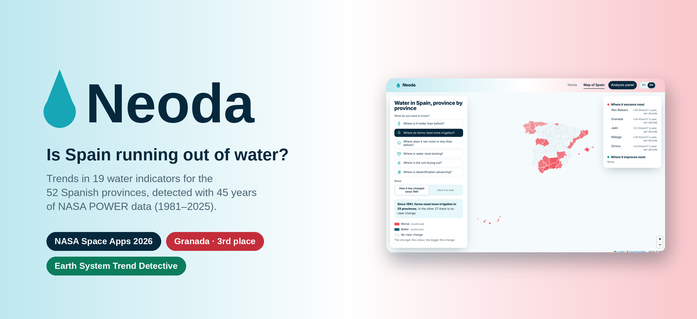
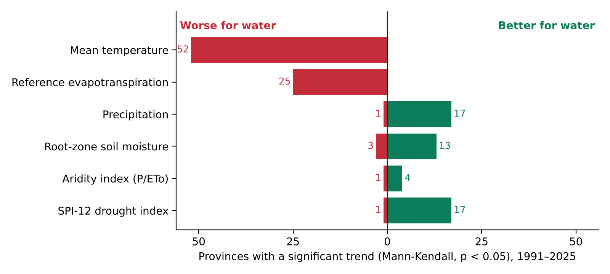
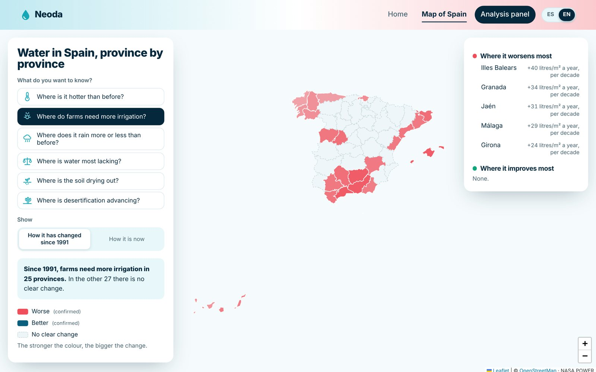
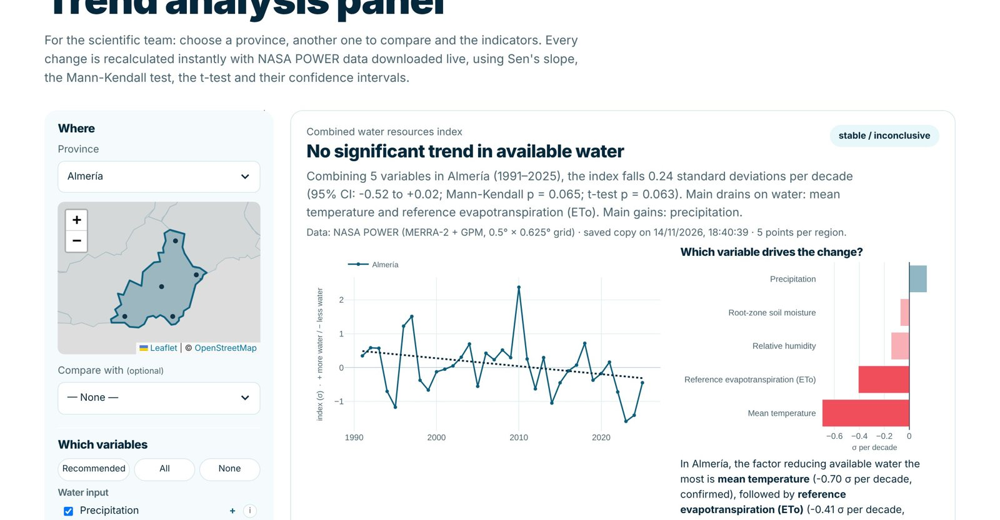
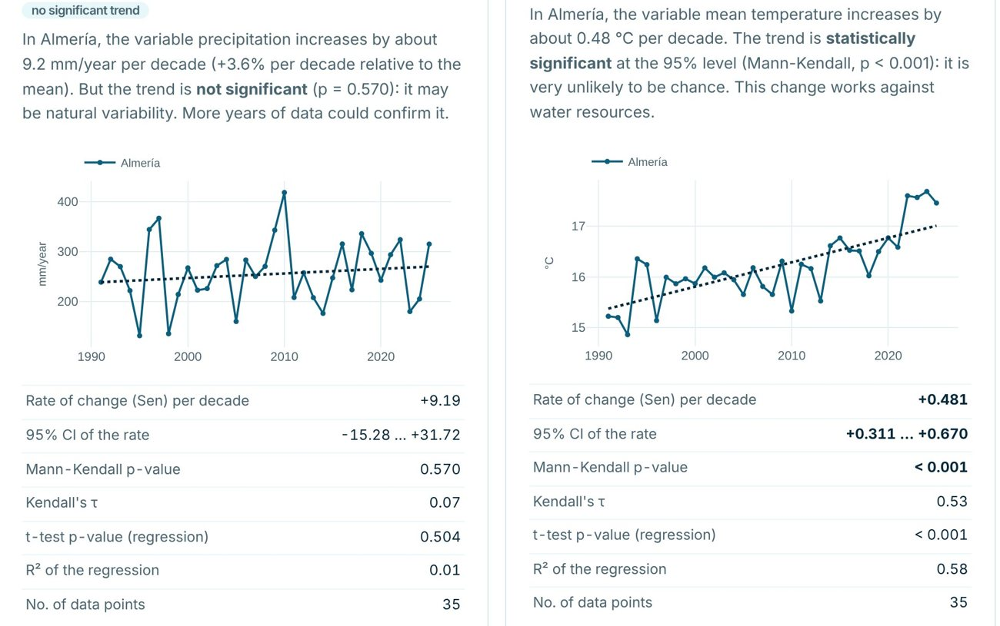
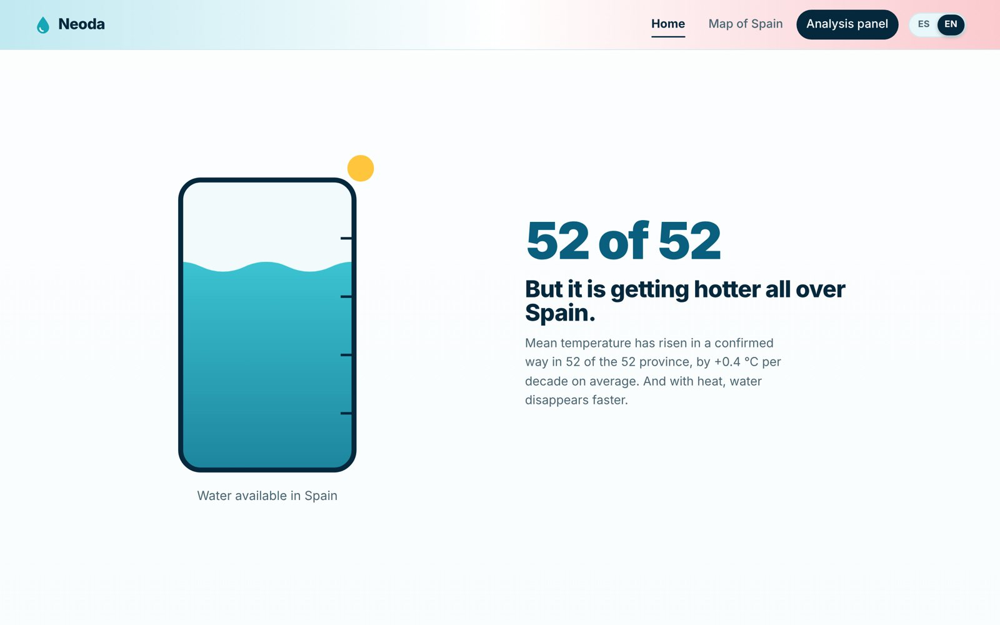
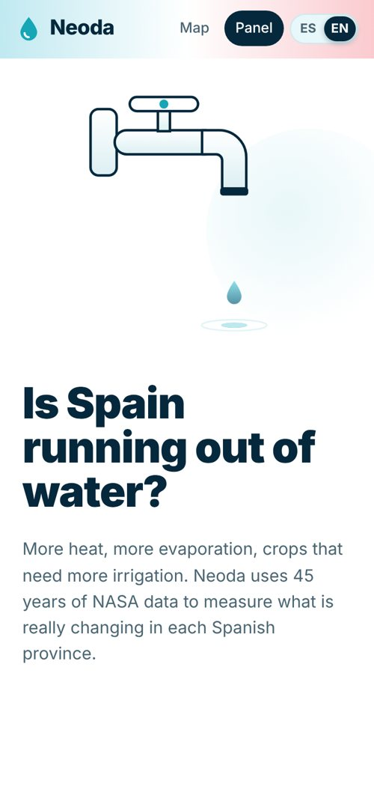
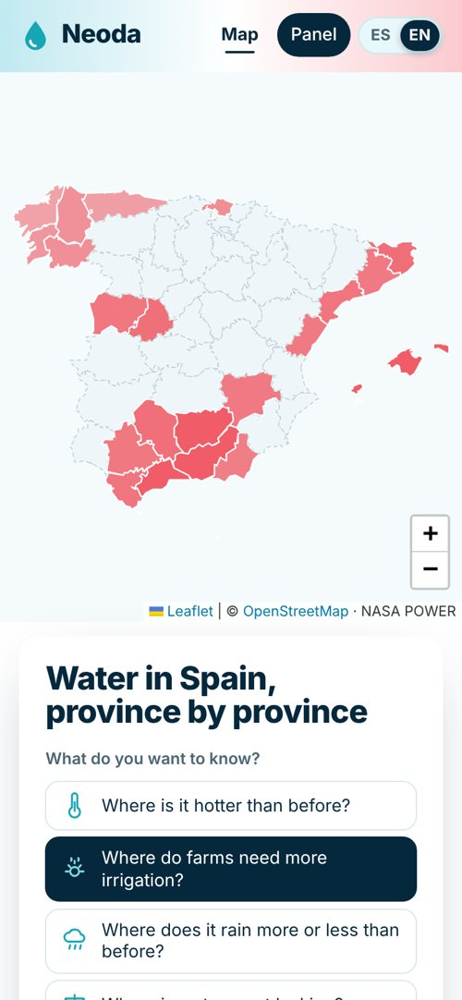
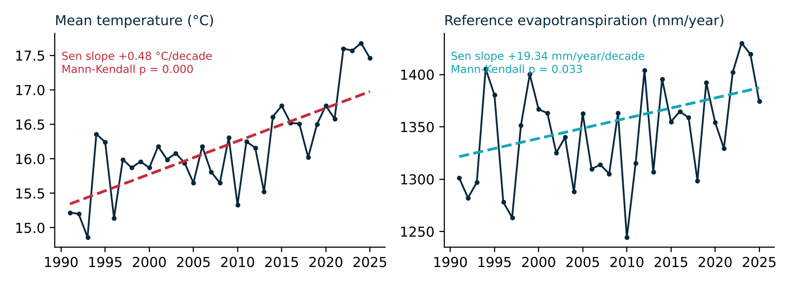

<p align="center">
  
</p>

<p align="center">
  <a href="https://fpanero.github.io/Neoda_Heeramienta_Medicion/"></a>
  <a href="https://fpanero.github.io/Neoda_Heeramienta_Medicion/media/neoda-demo.mp4"></a>
  <a href="docs/Neoda_SpaceApps2026_Report.pdf"></a>
</p>

<p align="center">
  
  
  
  
  
</p>

---

## 💧 What is Neoda?

**Neoda detects — it does not predict — statistically significant trends in 19 water indicators for the 52 Spanish provinces**, using 45 years of **NASA POWER** data. It turns a large Earth-system dataset into answers anyone can understand: *Where is it getting hotter? Where do farms need more irrigation? Is it really raining less?*

> **The headline finding (1991–2025):** temperature rises in **all 52 provinces**, crop water demand (evapotranspiration) rises in **25**, but rainfall has **not** fallen (it rises in 17, falls in 1). The pressure on water in Spain comes from **heat and evaporation**, not from less rain.

<p align="center"></p>

## 🗺️ Three views, one question

| 🏠 Home | 🗺️ Map of Spain | 📊 Analysis panel |
|---|---|---|
| A scroll story that explains the water problem, plus a 30-second demo video. | All provinces coloured by a plain-language question, with a ranking. Faded = not significant. | For scientists and water managers: full statistics, combined index, drivers and a PDF report. |

<p align="center"></p>
<p align="center"><em>"Where do farms need more irrigation?" — 25 provinces with a confirmed increase since 1991.</em></p>

<p align="center"></p>
<p align="center"><em>Analysis panel for Almería: verdict in plain words, combined water index and the variables driving the change.</em></p>

<p align="center"></p>
<p align="center"><em>One card per indicator: interpretation, trend line and full statistics (Sen slope + 95% CI, Mann-Kendall, t-test).</em></p>

<table>
<tr>
<td width="62%"></td>
<td width="19%"></td>
<td width="19%"></td>
</tr>
<tr><td align="center"><em>Scroll story on the home page</em></td><td align="center" colspan="2"><em>Works on mobile</em></td></tr>
</table>

## ⚙️ How it works

```
NASA POWER API ──► 1–6 land points per province ──► monthly series 1981–2025
        │                                                  │
        ▼                                                  ▼
 15 direct variables + 4 computed            Mann-Kendall · Sen slope + CI · OLS t-test
 (FAO-56 ETo, P − ETo, aridity, SPI-12)                    │
                                                           ▼
                       Combined water index (signed z-scores) + drivers ──► map · panel · PDF
```

1. **Data** — the browser calls the NASA POWER monthly point API live (no key). A backup copy is rebuilt by GitHub Actions on every deploy and every week.
2. **Indicators** — 15 NASA POWER variables + reference evapotranspiration (FAO-56 Penman-Monteith), water balance, aridity index (UNEP) and SPI-12.
3. **Statistics** — Mann-Kendall with tie correction, Sen's slope with confidence interval, least-squares regression with t-test; monthly anomalies remove seasonality.
4. **Validation** — checked against pymannkendall, SciPy and FAO-56 Example 17; 6 automated tests run on every deploy.

<p align="center"></p>

## 🛰️ NASA data

| NASA POWER parameter | Indicator |
|---|---|
| `PRECTOTCORR`, `PRECSNOLAND` | Precipitation, snowfall |
| `T2M`, `T2M_MAX`, `T2M_MIN`, `T2M_RANGE` | Temperature |
| `RH2M`, `QV2M` | Humidity |
| `WS10M`, `WS2M` | Wind |
| `ALLSKY_SFC_SW_DWN`, `CLOUD_AMT`, `PS` | Radiation, clouds, pressure |
| `GWETTOP`, `GWETROOT`, `GWETPROF` | Soil moisture |

*The data was obtained from the National Aeronautics and Space Administration (NASA) Langley Research Center (LaRC) Prediction Of Worldwide Energy Resources (POWER) Project funded through the NASA Earth Science Division.*

## 🌍 Impact and next steps

- **Evidence instead of anecdotes** — separates a real trend from a dry year.
- **Useful for decisions** — cooperatives, municipalities and river basin authorities.
- **Free and accessible** — no account, mobile, bilingual, shareable link or PDF.
- **Scalable** — NASA POWER is global: any region can be added. Next: NASA GRACE (groundwater), MODIS (vegetation), Copernicus, alerts and an API.

**Limitations:** satellites do not see desalination or groundwater pumping; the grid is ~50 km; correlation is not causation.

## 🧰 Tech stack

HTML · CSS · JavaScript (no framework) · Plotly.js · Leaflet · jsPDF · Python (Shapely, NumPy, SciPy, pymannkendall, pytest) · Node.js · GitHub Pages + Actions · Remotion (demo video)

```bash
cd web && python3 -m http.server 8000      # run locally → http://localhost:8000
pip install numpy scipy pymannkendall pytest && pytest pipeline/tests   # tests (needs Node.js)
```

<details>
<summary><b>📁 Repository structure</b></summary>

```
web/                     the app (published as-is on GitHub Pages)
  config/variables.json  catalogue of 19 indicators
  config/regions.json    53 regions and their sampling points
  js/power.js            NASA POWER download + FAO-56, balance, aridity, SPI-12
  js/stats.js            Mann-Kendall, Sen, OLS, anomalies, z-scores
  js/app.js              interface
  media/                 demo video
pipeline/                backup data, sampling points, map data, tests
docs/                    data contract, report (PDF) and images
```
</details>

## 🤖 Use of AI

- **Code:** much of this repository's code (web app, data pipeline and tests) was written with the help of an AI coding assistant, **Claude (Anthropic)**, under the team's direction and review. Commits co-authored by Claude are marked in the history. The statistics were validated against independent libraries. The app contains no AI model and no data was generated by AI.
- **Demo video:** contains AI-generated material and shows a visible **"AI generated"** watermark. No NASA logos are used in AI-generated content.
- **Report and README:** texts drafted with Claude and reviewed by the team; charts are generated by code from NASA POWER data; screenshots are of the real app.

## 📚 Credits

[NASA POWER](https://power.larc.nasa.gov/) (data) · [click_that_hood](https://github.com/codeforgermany/click_that_hood) (province boundaries) · © [OpenStreetMap](https://www.openstreetmap.org/copyright) contributors (base map) · Plotly.js (MIT) · Leaflet (BSD-2) · jsPDF (MIT) · Archivo font (SIL OFL).
References: Allen et al. (1998) FAO-56 · Mann (1945) · Kendall (1975) · Sen (1968) · McKee et al. (1993) · UNEP (1992).

<p align="center"><sub>Made in Granada by Team NEODA · NASA Space Apps Challenge 2026</sub></p>
